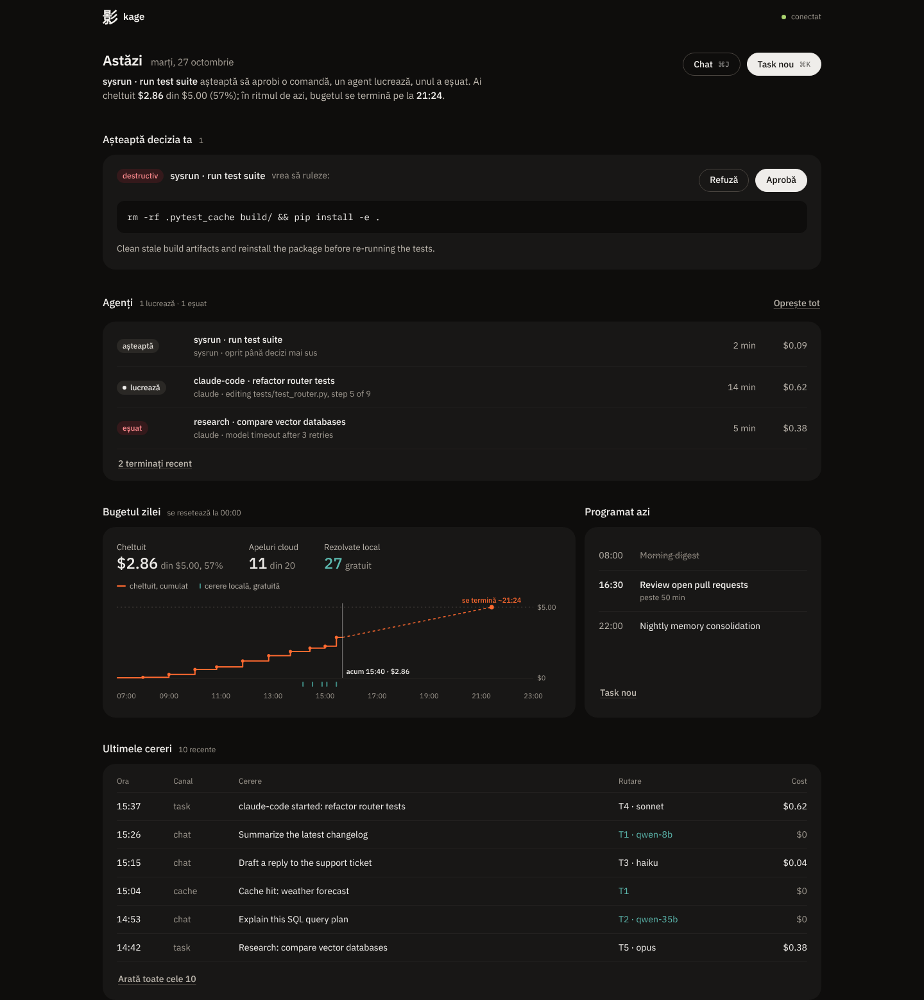
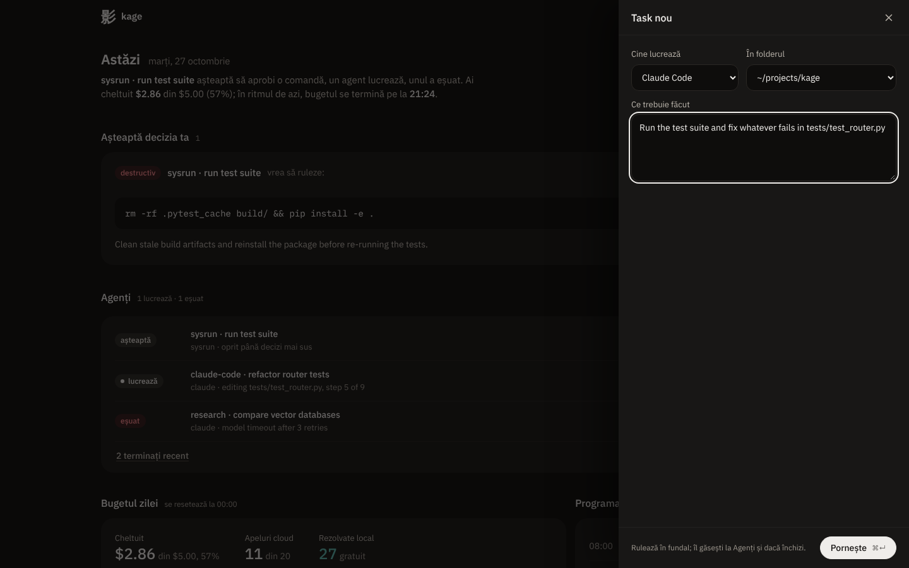
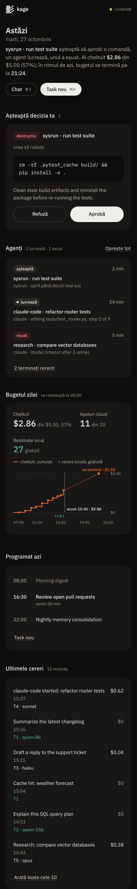
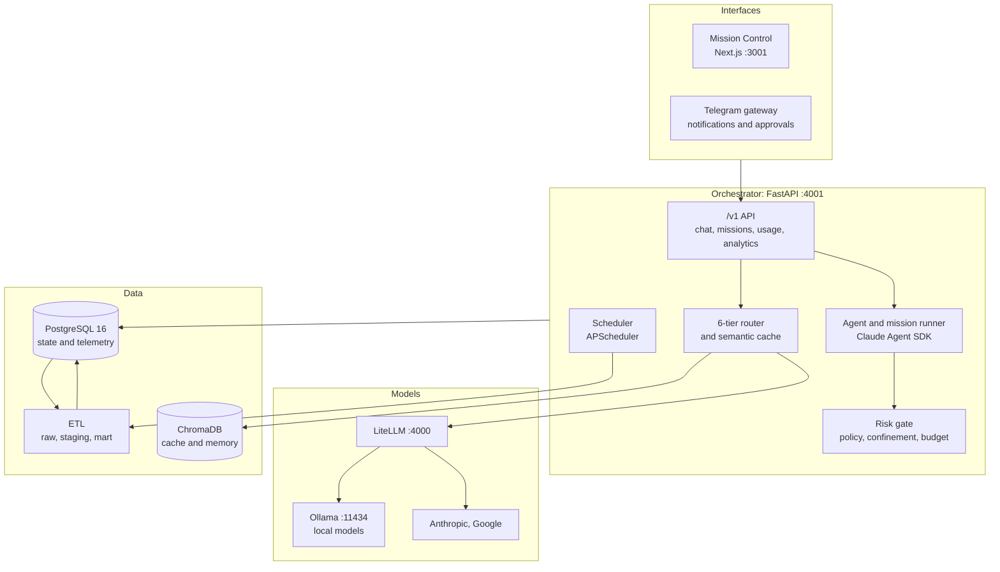

# Kage

A self-hosted orchestrator for personal AI work. It routes each request to the cheapest model
that can handle it, runs agents on your machine, and stops them before they do anything
irreversible until you approve it.

[](.github/workflows/ci.yml)


[](LICENSE)



<sub>Mission Control at 1440 px, rendered with sample data.</sub>

---

## What it does

- **Routes by difficulty.** Every message goes to one of six tiers. Tiers 1 and 2 are local
  models served by Ollama and cost nothing. Tiers 3 to 6 are cloud models (Claude, Gemini) and
  are only used when the task needs them. A semantic cache answers near-identical questions
  without calling a model at all.
- **Caps spending.** There is a hard daily limit on cloud calls and on dollars spent. Mission
  Control shows the running total and, at the current pace, the time the limit will be reached.
- **Runs agents.** `!run` starts a Claude Code agent in an allowed folder; `!sysrun` runs one on
  Kage's own code. Longer multi-step work runs as a *mission*: a plan you approve once, executed
  work package by work package.
- **Asks before risky actions.** Every tool call an agent makes is scored before it runs. Anything
  destructive (deleting files, force-pushing, installing into the system) waits for you to approve
  or deny it, from Telegram or from Mission Control.
- **Records everything.** Each request, run and decision is stored in PostgreSQL with its cost,
  model and outcome, so you can see afterwards what an agent did and what it cost.

## Mission Control

The web interface (`frontend/`, Next.js on port 3001) is a single page called *Today*. It shows,
in order of urgency:

1. **One sentence of status**: who is waiting for approval, how many agents are working or have
   failed, how much has been spent and when the budget runs out at today's pace.
2. **Waiting for your decision**: the exact command an agent wants to run, why, and Approve / Deny.
3. **Agents**: waiting, running and failed first; finished ones are folded away. One button stops
   them all.
4. **Today's budget**: cumulative cloud spend against the limit, with a projection. Orange marks
   paid cloud usage; teal marks requests answered locally for free.
5. **Scheduled today**: what already ran and what runs next.
6. **Latest requests**: time, channel, request, which tier answered it and the cost.

Chat (Cmd+J) and New task (Cmd+K) open in a side panel. If the orchestrator stops responding,
the page says why (wrong token or service down), keeps the last data on screen marked as stale,
and reconnects on its own.

<table>
<tr>
<td width="62%" valign="top">

<br><sub>New task: pick the agent and the allowed folder, describe the work.</sub>
</td>
<td width="38%" valign="top">

<br><sub>The same page on a 390 px phone.</sub>
</td>
</tr>
</table>

All screenshots use sample data served by a stand-in orchestrator.

## Architecture



Everything runs on one machine. The orchestrator is a single FastAPI process (`orchestrator.py`)
that owns routing, the agent runner, the scheduler and every HTTP endpoint. Mission Control and
the Telegram gateway are clients of it; neither talks to a model directly.

## How the pieces work

### Routing and cost

- Tier selection uses embeddings first, then a classifier, then simple heuristics as a fallback.
- Prefixes override the router when you want a specific tier (see [Chat prefixes](#chat-prefixes)).
- The semantic cache lives in ChromaDB. `!nocache` skips it for one message.

### Governance

- **Risk gate** (`risk_hook.py`): a PreToolUse hook that scores every tool call on reversibility,
  explicit intent and content. High-risk calls block until someone approves them. If the gate
  cannot reach a decision, the call is denied.
- **Workspace confinement**: an agent's working directory is resolved (so `..` and symlinks do not
  escape) and checked against an allow-list before any process starts.
- **Kill switch**: `!stop` halts every agent and pauses the scheduler; `!resume` restarts it.

These controls are mapped to an external standard rather than described in prose:

- [OWASP GenAI / LLM Top 10 (2026) mapping](docs/SECURITY-LLM-TOP10.md) links each of the ten
  risks to the control that addresses it, with line references, and lists eight things the
  design does not cover.
- [Detection lab in Microsoft Sentinel](docs/lab-azure-sentinel/) ships 481 real risk-gate
  decisions to Azure Log Analytics and adds three KQL detection rules mapped to MITRE ATT&CK.

### Data

- **PostgreSQL 16** holds state shared between processes: `usage`, `runs` and `run_events`,
  `missions` and `mission_wps`, `job_runs`, `scheduled_tasks`, `status`. The SQL is written by
  hand over `psycopg`, without an ORM. Chat history stays in SQLite because only one process
  uses it.
- **ETL** (`etl.py`) moves data from raw to staging to mart in plain SQL. Staging rows record when
  an event happened, when it became available and where it came from. Mart rows record which
  ETL run produced them. The unit of work is one day, so re-running a day produces the same rows.
- **Scheduled jobs** run inside the orchestrator with APScheduler: the nightly ETL, vault commit,
  cache cleanup, backup and heartbeat, plus any task you add with `!schedule`.

### Evaluation

**KageBench** (`kagebench.py`) replays a fixed set of tasks in a clean git worktree and records
success, cost, latency, turns, tool calls and approval requests, then compares the result with
the previous report. Run it before a large change; it is not part of every commit.

## Quick start

Requirements: macOS or Linux, Python 3.12, Node.js 20+, PostgreSQL 16,
[Ollama](https://ollama.com), and the [Claude CLI](https://docs.anthropic.com/claude-code) for
agent tasks.

```bash
git clone https://github.com/st3fansrb/kage.ai.git
cd kage.ai
bash scripts/setup.sh
```

`setup.sh` creates `kage_config.json` from `kage_config.example.json`. Fill in your API keys and
an API token, then pull the local models once:

```bash
ollama pull qwen3:8b
ollama pull qwen3.6:35b
ollama pull nomic-embed-text
```

Start everything:

```bash
./start_all.sh
```

| Service | Address |
|---|---|
| Mission Control | http://localhost:3001 |
| Orchestrator API | http://localhost:4001 (`/health` for a liveness check) |
| LiteLLM | http://localhost:4000 |

Mission Control reads its settings from `frontend/.env.local` (template:
`frontend/.env.local.example`):

- `KAGE_API_TOKEN` must match the API token in `kage_config.json`. If the page says the
  orchestrator refuses requests, these two do not match.
- `NEXT_PUBLIC_KAGE_LANG` sets the interface language: `ro` (default) or `en`. It is read at
  build time, so rebuild the frontend after changing it.

Full setup: [docs/INSTALL.md](docs/INSTALL.md). Restoring from a backup:
[docs/RESTORE.md](docs/RESTORE.md).

## Tests

```bash
source .venv/bin/activate && pytest
```

415 tests cover routing, budget, confinement, memory, backup and restore, ETL, the PostgreSQL
store, missions and the HTTP endpoints. Tests that need PostgreSQL are skipped when no database
is configured. [GitHub Actions](.github/workflows/ci.yml) runs the full suite against a real
`postgres:16` service on every push and pull request to `dev`.

## API

All endpoints except `/health` and `/v1/models` require `Authorization: Bearer <token>`.

| Endpoint | Purpose |
|---|---|
| `POST /v1/chat/completions` | OpenAI-compatible chat, streaming or not |
| `GET /v1/missions`, `POST /v1/missions` | List missions, create a mission |
| `GET /v1/usage` | Paginated usage and cost records |
| `GET /v1/analytics/daily` | Daily aggregates from the mart |
| `GET /health`, `GET /api/stats` | Liveness and live counters |
| `POST /admin/backup`, `POST /admin/etl` | Run a backup, backfill the ETL |

## Chat prefixes

Messages without a prefix go through the router. A prefix forces a specific behaviour.

| Prefix | Effect |
|---|---|
| `!fast`, `!best`, `!opus` | Force tier 1 (local), tier 5 or tier 6 |
| `!plan`, `!retry`, `!nocache` | At least tier 2; one tier higher than last time; skip the cache |
| `!run`, `!sysrun` | Start an agent task in an allowed folder, or on Kage's own code |
| `!mission new`, `!mission start <slug>` | Draft a mission plan for approval; run an approved one |
| `!save [path]` | Save the answer to the notes vault |
| `!schedule "CRON" message` | Add a scheduled task |
| `!briefing` | Send the daily digest now |
| `!status`, `!stop`, `!resume`, `!help` | Snapshot, kill switch, resume the scheduler, list prefixes |

## Repository layout

| Path | Contents |
|---|---|
| `orchestrator.py` | Routing, cache, memory, budget, agents, scheduler, all endpoints |
| `risk_hook.py`, `policy.yaml` | Risk gate and its policy |
| `pg_store.py`, `etl.py` | PostgreSQL store and the ETL pipeline |
| `mission_runner.py`, `agent_runner.py` | Mission and agent execution |
| `telegram_gateway.py` | Telegram bot: notifications and approvals |
| `frontend/` | Mission Control (Next.js) |
| `scripts/` | Setup, start and stop scripts |
| `docs/` | Install, restore, roadmap, security mapping, detection lab |
| `tests/` | pytest suite |

## Documentation

- [docs/DESPRE_KAGE.md](docs/DESPRE_KAGE.md): what Kage is and does (Romanian)
- [docs/ROADMAP.md](docs/ROADMAP.md): history of the project phases and scope decisions
- [docs/SECURITY-LLM-TOP10.md](docs/SECURITY-LLM-TOP10.md): OWASP GenAI / LLM Top 10 mapping
- [docs/lab-azure-sentinel/](docs/lab-azure-sentinel/): risk-gate telemetry in Microsoft Sentinel

## License

[AGPL-3.0](LICENSE). Free for personal and open-source use. For commercial use without the AGPL
obligations (a hosted service or a closed-source product), contact
`stefan.andrei.sirbu@gmail.com`.
